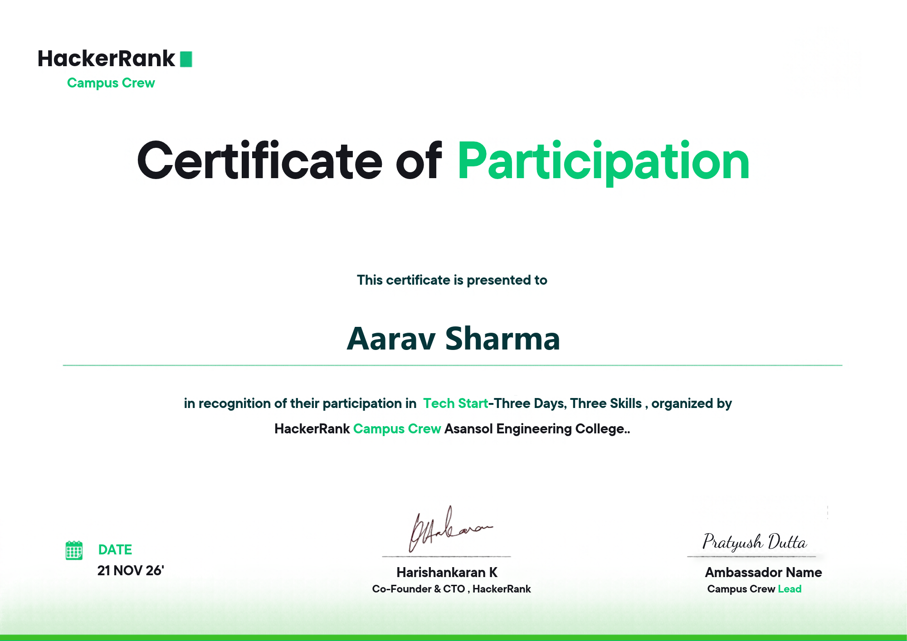

# Bulk Certificate Generator 🎓

A fast, pure-Python web application to generate personalized certificates in bulk from an Excel or CSV file. Built using **Streamlit**, **Pillow**, and **Pandas**.



---

## Features

- **Spreadsheet Ingestion**: Supports `.csv`, `.xlsx`, and `.xls` files with automatic column detection.
- **Interactive Live Preview**: Preview any participant's rendered certificate in real-time before bulk exporting.
- **Dynamic Centering & Auto-Scaling**: Long names automatically downscale so they never exceed certificate borders.
- **Template Placeholder Masking**: Automatically clears embedded placeholder text while preserving the decorative underline and certificate layout.
- **Bulk Export Formats**:
  - `PNG Archive (.zip)`: Individual high-resolution PNGs ($2000 \times 1414\text{ px}$).
  - `PDF Archive (.zip)`: Individual PDF files for each participant.
  - `Single Merged PDF (.pdf)`: One multi-page printable document containing all certificates.
- **Customizable Typography**: Adjust font family, font size, text color, capitalization, and vertical position directly from the UI sidebar.

---

## Quick Start

### 1. Activate Environment
```bash
# Windows
.\.venv\Scripts\Activate.ps1
```

### 2. Install Dependencies
```bash
pip install -r requirements.txt
```

### 3. Launch the Application
```bash
streamlit run app.py
```
Open your browser at `http://localhost:8501`.

---

## Project Structure

```
certificate_generator/
├── assets/
│   ├── tech-start cert temp.png     # Default certificate template (2000x1414)
│   ├── sample_participants.csv      # Ready-to-use sample dataset
│   └── fonts/                       # TrueType fonts (Segoe UI, Arial, Georgia)
├── core/
│   ├── __init__.py
│   └── generator.py                 # Core text rendering, auto-scaling & export engine
├── tests/
│   ├── test_generator.py            # Unit tests for core functions
│   └── verify_e2e.py                # End-to-end integration check
├── app.py                           # Streamlit UI
├── requirements.txt
└── README.md
```

---

## Running Tests

```bash
python -m unittest tests/test_generator.py
python -m tests.verify_e2e
```
